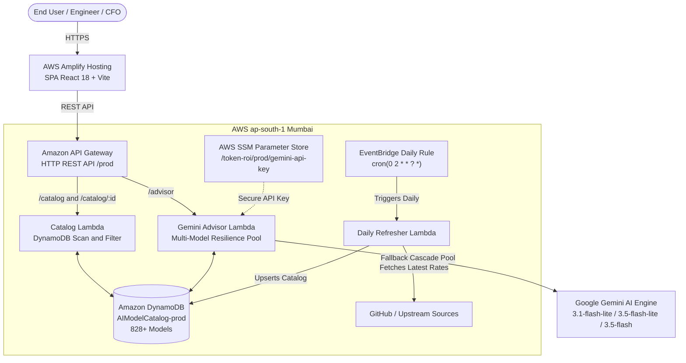

# AI Model Catalog & Token ROI Calculator

**Enterprise AI model intelligence, token pricing benchmarks, and multi-model workload ROI estimation.**

AI Model Catalog & Token ROI Calculator is a cloud-native intelligence platform designed for machine learning engineers, enterprise software architects, and financial decision-makers. It indexes **828+ production AI models** across 26 specialized domains and provides an interactive workload sizing engine, comparative cost forecasting, and an autonomous AI solutions advisor.

Google Gemini AI powers the interactive model recommendation engine with an automatic multi-model resilience pool. The catalog stays synchronized daily via Amazon EventBridge and AWS Lambda.

[](https://main.d25o9rjld4bvxg.amplifyapp.com)
[](https://www.python.org/)
[](https://react.dev/)
[](https://aws.amazon.com/serverless/)
[](https://aws.amazon.com/dynamodb/)

[Live Application](https://main.d25o9rjld4bvxg.amplifyapp.com) · [Download PDF User Guide](docs/AI_Model_Catalog_User_Guide.pdf) · [Interactive Visual Guide](docs/User-Guide.md) · [API Gateway Endpoint](https://fula8ai0tf.execute-api.ap-south-1.amazonaws.com/prod)

> Live infrastructure is hosted in AWS Region `ap-south-1` (Mumbai). All model token pricing rates represent live rates per 1M tokens with automatic batch, INR, and cloud markup conversions.

---

## Why

Choosing the right foundation model requires balancing benchmark capability, latency thresholds, and operating expenditure (OpEx). With over 800 models on the market, engineering teams face significant challenges:

| Need | AI Model Catalog & Token ROI Calculator |
| --- | --- |
| Benchmark 800+ models in one place | Comprehensive catalog of 828 models with verified accuracy tiers and benchmark scores |
| Separate flagship frontier models | Dedicated **Frontier Models (125)** tab featuring open-weight licenses, video/audio rates, and limits |
| Predict monthly token OpEx | Real-time sizing calculator modeling requests/day, prompt tokens, completion tokens, and days/month |
| Model provider batch discounts | 1-click **Batch pricing (50% OFF)** toggle for asynchronous workloads (OpenAI, Anthropic, Gemini) |
| Local currency budgeting | Real-time **Show ₹ INR** toggle at ₹84.5/USD |
| Enterprise cloud overheads | **Cloud provider markup** simulation (AWS +15%, Azure +18%, GCP +12%) |
| Automated AI architecture advice | Gemini AI Advisor asking 4 targeted domain clarifying questions before prescribing models |
| High-demand resilience | Multi-model fallback pool (`gemini-3.1-flash-lite` → `gemini-3.5-flash-lite` → `gemini-3.5-flash`) with exponential retry backoff |
| Automatic catalog maintenance | EventBridge daily cron (`02:00 UTC`) syncing rates directly to DynamoDB |

---

## Features

- **All Catalog Models Directory (828 Models):** Complete catalog with real-time keyword search, provider filtering, 26 domain sectors, A–Z sorting, and single-call token benchmarks.
- **Frontier Models Dedicated Sub-Tab (125 Models):** Curated flagships displaying open-source licenses (MIT, Apache 2.0, NVIDIA Open) vs. commercial APIs, per-second media rates, and context limits.
- **Live Searchable Combobox:** Autocomplete model search within the ROI Calculator displaying real-time input/output pricing rates.
- **Workload ROI Engine:** Accurate financial projection with customizable request volumes, prompt/output token ratios, and operational days.
- **Custom Model Comparison:** Add private or self-hosted fine-tuned weights via the custom pricing expander.
- **Interactive AI Solutions Advisor:** Multi-turn requirement analysis that poses 4 in-depth clarifying questions regarding volume, privacy, accuracy vs cost, and structural output fidelity.
- **Full Data Export:** Download complete multi-model comparison matrices to CSV for finance reviews.
- **Responsive Dark/Light Theme:** Built using a modern Tailwind/Inter glassmorphism design system.

---

## Architecture



### Flow

1. **Browse & Filter Catalog:** The frontend requests `/catalog` from API Gateway. The Catalog Lambda paginates through DynamoDB (`AIModelCatalog-prod`) and returns all 828 models sorted A–Z.
2. **Configure Workload:** The user specifies daily API requests, average input/output tokens, and selects models using the searchable combobox.
3. **Apply Pricing Adjustments:** Checkboxes apply batch discounts (50%), INR conversions (₹84.5/USD), or managed cloud provider markups.
4. **AI Advisor Consultation:**
   - **Stage 1 (Clarify):** The user enters a use case in natural language. Lambda prompts Gemini to generate 4 targeted, domain-specific multiple-choice questions.
   - **Stage 2 (Recommend):** The user submits their answers. Lambda filters candidate models in DynamoDB, and Gemini selects the **Top 3 Best-Fit** and **Top 3 Cost-Competitive** models.
5. **Daily Background Refresh:** EventBridge triggers `token-roi-daily-refresher-prod` daily at `02:00 UTC` to sync rates from upstream sources into DynamoDB with zero downtime.

---

## Tech Stack

| Layer | Technology |
| --- | --- |
| **Frontend** | React 18, Vite, Vanilla CSS Design System with Glassmorphism |
| **Hosting** | AWS Amplify (Mumbai `ap-south-1`) with SPA rewrite routing |
| **API** | Amazon API Gateway REST API (`/prod`) with CORS enabled |
| **Backend Compute** | Python 3.12, AWS Lambda (Serverless) |
| **Database** | Amazon DynamoDB (`AIModelCatalog-prod`) with On-Demand Capacity |
| **AI Recommendation** | Google Gemini API with multi-model fallback pool (`gemini-3.1-flash-lite`, `3.5-flash-lite`, `3.5-flash`) |
| **Scheduled Tasks** | Amazon EventBridge Daily Rule (`cron(0 2 * * ? *)`) |
| **Secrets Management** | AWS Systems Manager (SSM) Parameter Store (SecureString) |
| **Infrastructure as Code** | AWS SAM (Serverless Application Model) / CloudFormation |

---

## Getting Started

### Prerequisites

- **Python 3.12+** and **Node.js 18+** installed locally.
- **AWS CLI v2** and **AWS SAM CLI** configured with administrator credentials.
- A **Google Gemini API Key** (Free Tier supported).

### Local Frontend Development

1. Navigate to the frontend directory:
   ```bash
   cd frontend
   npm install
   ```
2. Start the Vite development server:
   ```bash
   npm run dev
   ```
   Open `http://localhost:5173` in your browser.

---

### Backend Deployment with AWS SAM

1. Navigate to the backend directory:
   ```bash
   cd backend
   ```
2. Build the SAM application:
   ```bash
   sam build
   ```
3. Deploy to AWS `ap-south-1`:
   ```bash
   sam deploy --guided
   ```
   - **Stack Name:** `token-roi-prod`
   - **AWS Region:** `ap-south-1`
   - **Parameter GeminiApiKey:** `YOUR_GEMINI_API_KEY`

4. Store your Gemini API key in SSM Parameter Store:
   ```bash
   aws ssm put-parameter \
     --name "/token-roi/prod/gemini-api-key" \
     --value "YOUR_GEMINI_API_KEY" \
     --type "SecureString" \
     --overwrite \
     --region ap-south-1
   ```

5. Seed DynamoDB with the 828 models:
   ```bash
   python backend/scripts/seed_dynamodb.py
   ```

---

## Project Structure

```
TokenROICalculator/
├── amplify.yml                       # AWS Amplify build & deployment configuration
├── README.md                         # Project documentation and architectural overview
├── .gitignore                        # Git exclusion rules
│
├── backend/                          # Serverless backend
│   ├── template.yaml                 # AWS SAM CloudFormation template
│   ├── functions/
│   │   ├── catalog/index.py          # Catalog listing and ID lookup Lambda
│   │   ├── bedrock-advisor/index.py  # Gemini AI Advisor Lambda with fallback pool
│   │   └── daily-refresher/index.py  # EventBridge daily catalog refresh Lambda
│   └── scripts/
│       └── seed_dynamodb.py          # Script to populate initial 828 models
│
├── frontend/                         # React SPA
│   ├── index.html                    # Single-page application entry point
│   ├── vite.config.js                # Vite build configuration
│   ├── package.json                  # Frontend dependencies
│   └── src/
│       ├── App.jsx                   # Main layout and tab router
│       ├── index.css                 # Custom glassmorphic styling system
│       ├── components/
│       │   ├── CatalogTab.jsx        # Dual-tab view (All 828 + Frontier 125)
│       │   ├── ROICalculator.jsx     # Workload ROI calculator & searchable selector
│       │   ├── ModelDetails.jsx      # Architectural & benchmark dossier inspector
│       │   └── BedrockAdvisor.jsx    # Gemini AI multi-turn interactive questionnaire
│       ├── data/
│       │   └── frontierModels.json   # Curated 125 flagship frontier models
│       └── utils/
│           ├── api.js                # REST API client for API Gateway endpoints
│           └── pricing.js            # Workload calculation & cloud markup formulas
│
└── docs/                             # User manuals & documentation
    ├── AI_Model_Catalog_User_Guide.pdf   # Publication-ready downloadable PDF
    ├── AI_Model_Catalog_User_Guide.html  # Standalone printable HTML user manual
    ├── User-Guide.md                     # Markdown visual step-by-step user guide
    └── guide_images/                     # High-resolution production screenshots
        ├── all_catalog_828.jpg
        ├── frontier_models_125.jpg
        ├── token_roi_calculator.jpg
        ├── model_details_inspector.jpg
        └── ai_advisor.jpg
```

---

## Cost Controls

- **Serverless On-Demand:** DynamoDB is configured with `PAY_PER_REQUEST` billing mode, generating zero idle costs when unused.
- **Free-Tier Optimized AI Advisor:** Google Gemini API Free Tier provides generous RPM limits. The multi-model fallback cascade prevents unnecessary escalations to paid tiers.
- **Zero Server Overhead:** AWS Lambda functions are invoked purely on request with 256MB memory allocations.
- **Static Asset Caching:** AWS Amplify serves compiled static assets with low-latency edge caching.

---

## Security Notes

- **Secrets Isolation:** No API keys are embedded in frontend client bundles. The Gemini API key is stored securely in AWS SSM Parameter Store as an encrypted `SecureString` and retrieved exclusively at Lambda runtime.
- **CORS Protection:** API Gateway endpoints enforce strict cross-origin resource sharing headers.
- **Input Sanitization:** All user query strings and clarifying answers are strictly validated and parsed prior to model invocation.

---

## Documentation

| Document | Format | Description |
| --- | --- | --- |
| [PDF User Manual](docs/AI_Model_Catalog_User_Guide.pdf) | PDF | Publication-ready visual user guide with screenshots and step-by-step instructions |
| [Interactive HTML Guide](docs/AI_Model_Catalog_User_Guide.html) | HTML | Standalone printable guide with base64 embedded images |
| [Markdown Visual Guide](docs/User-Guide.md) | Markdown | Repository user guide formatted with screenshots and Pro-Tip callouts |

---

## License

MIT License. Feel free to use, customize, and extend for your enterprise workloads.
